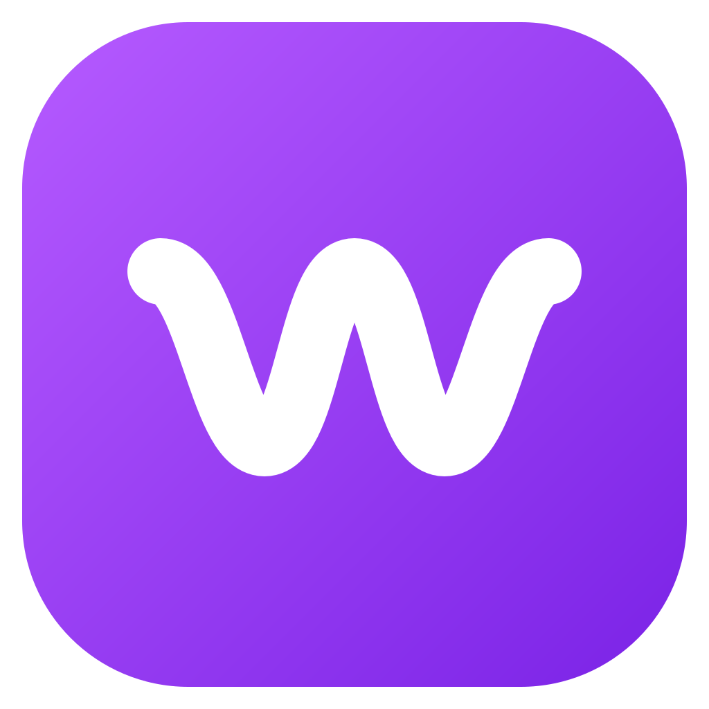

# Wavekeep

<p align="center">
  
</p>

> Wavekeep was previously called **Deezy**. Updating keeps your settings, download history, themes and saved logins (the startup warning shows once more); see [Upgrading from Deezy](#upgrading-from-deezy).

A modern desktop Deezer, Spotify, SoundCloud and YouTube downloader. Search for tracks, albums, artists, and playlists, paste music URLs for direct download, and save audio with full metadata and cover art.

[](https://discord.gg/dvuWBeXSf3)
[](https://github.com/PierrunoYT/Wavekeep/releases/latest)

---

## ⚠️ Important Information

**This tool is for educational and personal use only.** By using Wavekeep, you acknowledge and agree to the following:

- **Deezer Account Required** – You need a Deezer account (Free or Premium) for the Deezer source. The ARL token is tied to your account.
  - **Free accounts** are limited to MP3 128 kbps downloads
  - **Premium accounts** can download MP3 320 kbps or FLAC
  - The **Spotify source** needs a **Spotify Premium** account and uses a browser OAuth login; it does not need an ARL. Spotify Free accounts cannot be used: the Spotify library Wavekeep is built on (librespot) shuts down the whole program when it connects to a Free account. Wavekeep 0.3.0 therefore closed right after the login; since 0.4.0 it checks the account type first and refuses to connect with "Spotify Premium is required". Quality is limited to the formats Spotify returns for each track, and the best match for the selected setting is used.
  - **SoundCloud** and **YouTube** need no account. YouTube needs yt-dlp, Deno and ffmpeg installed on your PATH (see [YouTube](#youtube)).
  - A **custom Spotify Client ID** (Development-mode app) may have its own restrictions on Spotify's side, such as limited user access or a Premium requirement for the app owner; these are Spotify's rules and are not enforced or checked by Wavekeep.
- **Terms of Service** – Downloading music may violate the [Deezer](https://www.deezer.com/legal/cgu), [Spotify](https://www.spotify.com/legal/end-user-agreement/), [SoundCloud](https://soundcloud.com/pages/terms) or [YouTube](https://www.youtube.com/t/terms) terms of service. Use at your own risk.
- **Account Blocking Risk** – Your account may get suspended. Deezer and Spotify can detect unusual download activity.
- **Copyright Laws** – Respect copyright laws in your jurisdiction. Downloaded content is for personal use only and must not be redistributed.
- **No Warranty** – This software is provided "as is". The authors are not responsible for any misuse or legal consequences.

**By using this software, you accept full responsibility for your actions.**

---

## Features

- **Search** – Find tracks, albums, artists, and playlists on Deezer, Spotify, SoundCloud or YouTube (YouTube has no albums) with debounced search
- **Spotify source** – Download through librespot with full metadata and cover art; at each bitrate OGG Vorbis is preferred over MP3; FLAC is only requested for the Lossless setting, and if a track has none of the usual formats, whatever Spotify offers (such as AAC) is used
- **SoundCloud source** - Search and download from SoundCloud without an account; the best stream SoundCloud serves is saved (today usually AAC 160 kbps as `.m4a`, or MP3 128) with title, artist, year and artwork, plus album and ISRC when SoundCloud has them. Tracks SoundCloud only offers as DRM-protected streams (common for major-label releases) need a Widevine device you pick in Settings; tracks that only have a 30-second preview are not downloaded
- **YouTube source** - Search and download from YouTube without an account, using yt-dlp, Deno and ffmpeg installed on your PATH; the audio is saved without re-encoding (Opus as `.ogg`, AAC as `.m4a`, or MP3) with title, channel name as artist, year of the upload and thumbnail
- **URL download** – Paste full `deezer.com`, `open.spotify.com`, `soundcloud.com`, `youtube.com` or `youtu.be` track, album, artist, or playlist URLs to add their content to the queue
- **Audio preview** – Play 30-second Deezer previews before downloading
- **Smart queue** – 1 to 10 simultaneous downloads (3 by default) with drag-and-drop reordering, pause/resume, and retry
- **Your library** – Open your Deezer or Spotify Loved Tracks and your own playlists, including private ones, next to the search tabs
- **Album & playlist download** – Download all tracks with one click, or open an album or playlist to pick individual tracks
- **Skip existing files** – Tracks whose audio file is already at the destination are skipped, even after clearing history
- **Download pacing** – Optional pause between downloads and a total speed limit, including presets that match playback speed
- **Quality options** - Deezer MP3 128, MP3 320, or FLAC; Spotify 96/160/320 kbps or lossless FLAC, with format fallback; SoundCloud always takes its best stream (Widevine-encrypted ones need a `.wvd` device file chosen in Settings); YouTube takes the best audio stream (Opus, then AAC, then MP3)
- **Full metadata** – Title, artist, album, year, track and disc number, and cover art embedded; Deezer downloads also fill the album-artist tag (with the track's main artist), which Spotify downloads do not
- **Folder structure** – Organize downloads as Flat, Artist/Track, Artist/Album/Track, Album/Track, or with a custom template
- **Tag editor** – Edit metadata and cover art on any local MP3, FLAC, OGG, or M4A file (including Spotify downloads); files with an unreadable tag are reported and left untouched instead of being overwritten
- **Download history** – Persistent history with CSV/JSON export and open-in-file-manager
- **Themes** – Dark (the default), Light, System, and fully custom JSON themes
- **Internationalization** – English, Spanish, French, German, Portuguese, and Italian
- **Info & FAQ** – A warning about terms of service, account risk and credentials appears at startup (with a "Don't show this again" option), and the **Info & FAQ** button in the sidebar reopens it with a short FAQ and buttons to copy or open the local diagnostic log for bug reports, in all six languages
- **Keyboard shortcuts** – (Cmd instead of Ctrl on macOS) Ctrl+F, Ctrl+1/2/3, Ctrl+, (Settings), Ctrl+H (minimize to tray; on macOS the system Cmd+H hides the app instead), Esc (clear search / go back), Space, Shift+? and more
- **System tray** – Minimize to tray with download status and quick controls; closing the window hides it to the tray by default (turn off *Close to tray* in Settings to quit instead)
- **Manual updates** – Install Windows releases from GitHub or rebuild from source on macOS and Linux
- **Secure credentials** – ARL replacements are authenticated before storage, normally kept in the OS credential store, and redacted from `settings.json`; when secure storage is unavailable, a clearly indicated fallback keeps the ARL in plain text in `settings.json` (owner-only permissions on macOS and Linux)

These docs describe the current source. Changes under [Unreleased](CHANGELOG.md#unreleased) may not yet be included in the latest installer.

---

## Install

### Upgrading from Deezy

Your settings, download history, custom themes, saved Deezer and Spotify logins, and downloaded music all carry over. The first time Wavekeep starts, it moves them from Deezy's data folder and credential entries (`com.pierr.deezy`) to its own (`com.pierr.wavekeep`).

- **`.msi` installer:** upgrades the existing Deezy installation in place.
- **`.exe` installer:** installs Wavekeep next to Deezy, because it is keyed on the app name. **Start Wavekeep once before you uninstall Deezy**, so your data has been moved; after that, uninstalling Deezy is safe. If you uninstall Deezy first and tick "Delete the application data", its uninstaller deletes your settings, history and themes before Wavekeep can move them. Your music files are not affected either way.
- Once moved, the data belongs to Wavekeep: the old Deezy app starts with default settings and no saved logins.

### Windows

Download the latest installer from the [Releases page](https://github.com/PierrunoYT/Wavekeep/releases/latest):

- `.exe` (NSIS installer) — recommended
- `.msi` (MSI package)

### macOS & Linux

No pre-built binaries are available yet. Install the [Tauri prerequisites](https://v2.tauri.app/start/prerequisites/) for your operating system, plus [Bun](https://bun.sh/), Node.js with npm (the Tauri build runs `npm run build`), and the stable Rust toolchain, then build from source:

```bash
git clone https://github.com/PierrunoYT/Wavekeep.git
cd Wavekeep/deezy
bun install --frozen-lockfile
bun run tauri build
```

Install the output from `src-tauri/target/release/bundle/` (`.dmg` on macOS, `.deb` / `.rpm` / `.AppImage` on Linux).

> **Update note:** Wavekeep does not currently include an automatic updater. Pull the latest source, run `bun install --frozen-lockfile`, and run `bun run tauri build` again to update a source-built installation.

### Amp development orbs

Amp automatically runs the executable `.agents/setup` script when creating a fresh orb. It installs the Linux packages and toolchains required by Tauri (including Node.js 22 with npm when no Node 20+ is present, since Tauri runs `npm run dev`/`npm run build`), installs the locked frontend dependencies, and pre-builds the Rust dependencies and test target. On resume, `.agents/resume` verifies that the toolchains and frontend dependencies are ready; Wavekeep has no background services to restart.

---

## Get your Deezer ARL token

1. Log into [deezer.com](https://www.deezer.com)
2. Open DevTools (`F12`) → **Application** (Chrome) or **Storage** (Firefox) → **Cookies** → `https://www.deezer.com`
3. Copy the complete value of the `arl` cookie

> Treat the ARL like a password. Wavekeep normally stores it in Windows Credential Manager, macOS Keychain, or Linux Secret Service and excludes it from `settings.json`. If secure storage is unavailable or cannot be read (for example, no running Secret Service on Linux), Wavekeep can use a clearly indicated fallback that keeps the ARL in plain text in `settings.json` (restricted to your user on macOS and Linux; on Windows only the normal per-user folder permissions apply). A replacement is authenticated before the working credential is changed. The ARL can expire or be invalidated and may need to be updated.

---

## Connect Spotify

Open **Settings → Spotify** and click **Connect Spotify**. Complete the browser OAuth login, then select Spotify as the music source in Search. No Deezer account or ARL is required. Spotify OAuth tokens are stored separately from the ARL in the OS credential store when available.

Wavekeep normally uses librespot's shared Client ID. Because every librespot install shares its Web API quota, search can hit `429` rate limits. To avoid that, add `http://127.0.0.1:5588/login` as a redirect URI in your own Spotify Developer Dashboard app, paste its Client ID into **Settings → Spotify Client ID**, and reconnect. Your ID is used only for search and library requests; downloads still use the default ID, since Spotify rejects track metadata requests from other Client IDs. Connecting with a custom ID opens the browser login twice — approve both. Changing the saved ID while connected disconnects you, and clearing the field restores the default.

Track metadata, downloads, Loved Tracks and the tracks of a playlist or album go through the AP session independently of Web API search quotas, but search itself (and playlist search and your playlist list, which have no fallback) uses the Web API and its quota. A Pathfinder search fallback exists for rate-limited track, album, and artist searches, but Spotify currently refuses it, so a custom Client ID is the reliable fix for `429` errors.

## SoundCloud

Choose **SoundCloud** as the music source in Search; no account or setting is needed. Wavekeep uses the same anonymous access as the soundcloud.com web player (it reads the public client ID from soundcloud.com, or from `WAVEKEEP_SOUNDCLOUD_CLIENT_ID` if set). Opening an artist shows **All tracks** (their uploads, up to 500) followed by their albums and playlists; pasting a profile link queues their uploads after asking. There are no Loved Tracks or My Playlists tabs for SoundCloud, no previews, and no quality setting: the best stream SoundCloud serves is downloaded, today usually AAC 160 kbps. Many major-label releases are only offered as Widevine-encrypted streams; pick a Widevine device file (`.wvd`) under **Settings → SoundCloud DRM** and those are downloaded too, usually AAC 256 kbps. Without a device they fail with a message saying so, as do tracks that only have a 30-second preview (Go+ or region-restricted). The licence exchange and decryption happen inside Wavekeep; nothing else has to be installed, and the device file stays on your computer.

## YouTube

Choose **YouTube** as the music source in Search; no account or setting is needed. YouTube needs three free tools installed and on your PATH: [yt-dlp](https://github.com/yt-dlp/yt-dlp), [Deno](https://deno.com/) (yt-dlp needs a JavaScript runtime for YouTube) and [ffmpeg](https://ffmpeg.org/). Restart Wavekeep after installing them. If yt-dlp or ffmpeg is missing, Wavekeep says "YouTube needs yt-dlp on PATH" (or ffmpeg). If YouTube stops working, update yt-dlp first.

Search has **Tracks** (videos, up to 20), **Artists** (channels found through video search, up to 10, without pictures) and **Playlists** (up to 20). There is no Albums tab and no Loved Tracks or My Playlists tabs. Opening an artist shows **All tracks** (the channel's uploads, up to 1000) followed by the channel's playlists (up to 120); playlists load up to 1000 items.

yt-dlp only finds the metadata and the audio stream (WebM Opus preferred, then M4A AAC, then MP3); Wavekeep downloads the audio itself, through the shared speed limit, and ffmpeg repackages it without re-encoding: Opus is saved as `.ogg`, AAC as `.m4a`, MP3 as `.mp3`. Files are tagged with title, artist (the channel name), album (the YouTube Music album when there is one, otherwise "YouTube", which is also the album folder), year (from the upload date, which also fills `{release_date}` in folder templates) and the video thumbnail as cover. There are no previews.

Supported links: `youtube.com`, `www.`, `m.` and `music.youtube.com`, and `youtu.be`. Video links (`watch?v=`, `youtu.be/<id>`, `/shorts/`, `/embed/`, `/live/`) add one track; playlist links (`/playlist?list=`, or `/watch?list=` without `v=`) add the playlist; channel links (`@handle`, `/channel/UC…`, `/c/<name>`, `/user/<name>`) add the channel's uploads after asking. When a link has both `v=` and `list=`, only the video is added.

---

## Usage

1. **Setup** – For Deezer, paste your ARL token and click **Save & Login**; for Spotify, use **Connect Spotify** (Premium only). SoundCloud and YouTube need no login. Choose a download folder, the Deezer **Audio Quality** and the Spotify quality
2. **Search** – Switch to Search (Ctrl+1), choose Deezer, Spotify, SoundCloud or YouTube, type a query, and press Enter. For Deezer and Spotify, the **Loved Tracks** and **My Playlists** tabs list your own library
3. **Paste URLs** – Paste a full `deezer.com`, `open.spotify.com`, `soundcloud.com` or `youtube.com`/`youtu.be` track, album, artist, or playlist URL to add its content to the queue
4. **Preview** – Click ▶ to preview a Deezer track; Space bar to play/pause
5. **Download** – Click the download button on a track, or **Download All** on an album or playlist. Click an album or playlist title, including albums in an artist's discography, to see its tracks
6. **Manage Queue** – Drag to reorder, pause/resume, or remove pending downloads (Ctrl+2)
7. **History** – View completed downloads, open files in Explorer/Finder, or export history
8. **Customize** – Change theme, language, folder structure, notifications, search history, track details in the log, close to tray, skipping of existing files, simultaneous downloads, download pacing, Spotify quality, Spotify Client ID, and the SoundCloud DRM device in Settings (Ctrl+3)
9. **Updates** – Download the latest Windows installer from GitHub Releases, or pull and rebuild on macOS and Linux
10. **Tray** – Minimize to tray (Ctrl+H, or the system Cmd+H on macOS); left-click the icon to show or hide the window

Pausing cancels the current transfer; resuming downloads the track again from the
beginning. Saved interrupted downloads appear as paused after restarting. Pending
queue entries are not persisted. Clearing history preserves active and queued
rows and does not delete downloaded files.

Deezer album, playlist, and artist loaders follow API pagination. If a later page fails,
the operation reports an error instead of silently returning an incomplete list.
Spotify lists can be shorter than on Spotify itself: unavailable tracks are
skipped, and an artist discography shows at most 120 releases.

### Custom folder templates

Choose **Custom** in Settings and use a template such as:

```text
{artist}/{release_date} - {album}/{track_number} - {title}
```

Supported placeholders are `{artist}`, `{album}`, `{title}`, `{track_number}`
(`{track}`), `{disc_number}` (`{disc}`), `{release_date}`, and `{release_year}`
(`{year}`). Template `/` and `\` separators create directories; separators in
metadata are sanitized, so an artist such as `AC/DC` stays in one directory.

---

## Reporting a problem

Open **Info & FAQ** in the sidebar, press **Copy recent log**, and paste it with a short description into a [GitHub issue](https://github.com/PierrunoYT/Wavekeep/issues) or the [Discord server](https://discord.gg/dvuWBeXSf3). **Open log folder** shows the whole file, `wavekeep-debug.log` in Wavekeep's logs folder (`%LOCALAPPDATA%\com.pierr.wavekeep\logs` on Windows, `~/Library/Logs/com.pierr.wavekeep` on macOS, and `~/.local/share/com.pierr.wavekeep/logs` on Linux). The system does not clean that folder up on its own.

**Privacy:**

- **Local only.** The log stays on your computer; Wavekeep never uploads it, and the app sends nothing to the developer (no analytics, telemetry or crash reports).
- **Never in the log:** passwords, your ARL, login tokens, and what you search for. Every line is also cleaned before it is saved: your home folder appears as `~`, web addresses lose their query part, and long token-like strings become `[redacted]`.
- **Track details are your choice.** By default the log includes track names, artists and file paths, which makes reports easier to follow. Turn off **Track Details in Log** in Settings to write `[hidden]` instead.
- **You control it.** **Copy recent log** copies the last 300 lines, **Delete log** removes the log and its rotated copy (`wavekeep-debug.old.log`, created once the log passes 1 MB), and you can read the file before sharing it.

See [What does Wavekeep collect or send?](FAQ.md#what-does-wavekeep-collect-or-send) for everything Wavekeep stores and how to remove it.

## Development

Install the Tauri prerequisites, stable Rust, Bun, and Node.js with npm. Run all
application commands from `deezy/`:

```bash
bun install --frozen-lockfile
bun run tauri dev
```

Before submitting a change:

```bash
npm test
npm run check
npm run build
cargo test --manifest-path src-tauri/Cargo.toml
```

See [Development guide](DEVELOPMENT.md) for the module layout, state ownership,
test coverage, and release checklist.

---

## License

MIT – see [LICENSE](LICENSE) for details.

## Resources

- [FAQ](FAQ.md) – Common questions about setup, security, and legal use
- [Changelog](CHANGELOG.md) – Full version history
- [Development guide](DEVELOPMENT.md) – Setup, architecture, testing, and releases
- [Code review](deezy/CODE_REVIEW.md) – September 2026 fixes and validation limits
